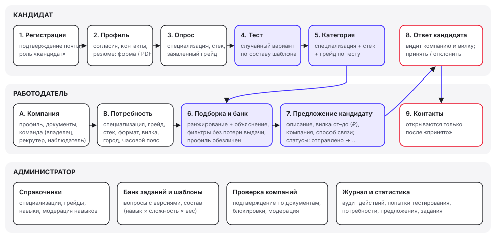
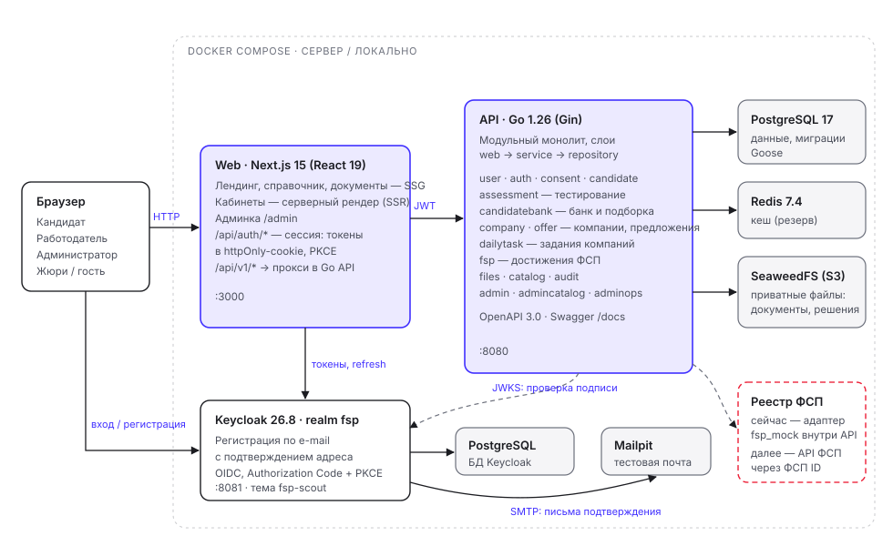
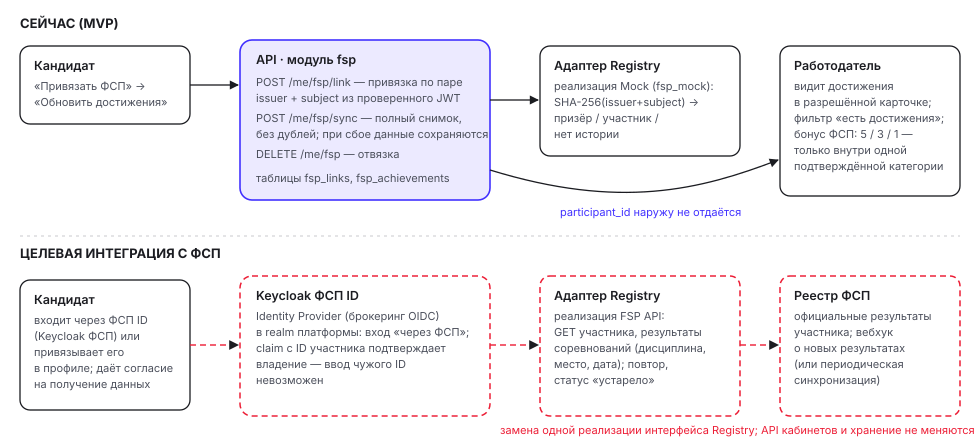

# ФСП Скаут — сопроводительная документация

Цифровая платформа подбора IT-специалистов с обратной механикой: кандидат подтверждает квалификацию тестом и получает категорию, работодатель сам находит кандидатов нужной категории и выходит на контакт с предложением и вилкой зарплаты. Документ построен по пунктам 3.4 технического задания.

Команда UNSALTED TEAM · трек ФСП · «Лидеры цифровой трансформации 2026» · версия от 11.10.2026, ветка `main`.

## Материалы сдачи

| Материал | Где |
| --- | --- |
| Развёрнутый прототип | http://89.104.69.242:3000 |
| Swagger UI и OpenAPI | http://89.104.69.242:8080/docs/ · http://89.104.69.242:8080/openapi.yaml |
| Репозиторий | https://github.com/Ix1ax/fsp-talent-lct-2026 |
| Презентация и скринкаст | папка `docs/submission` репозитория |
| Эта документация | `docs/submission/fsp-scout-documentation.pdf`, исходник — `docs/submission/documentation.md` |

### Демо-аккаунты

| Роль | Логин | Пароль | Где входить |
| --- | --- | --- | --- |
| Кандидат с заполненным профилем | `candidate@demo.fsp.test` | `1234` | «Войти» на сайте |
| Новый кандидат (путь с нуля) | `new-candidate@demo.fsp.test` | `1234` | «Войти» на сайте |
| Работодатель — владелец компании | `employer@demo.fsp.test` | `1234` | «Войти» на сайте |
| Рекрутер компании | `recruiter@demo.fsp.test` | `1234` | «Войти» на сайте |
| Сотрудник с правами просмотра | `viewer@demo.fsp.test` | `1234` | «Войти» на сайте |
| Администратор | `admin@demo.fsp.test` | `adminadminadmin` | `/admin` |
| Суперадминистратор | `superadmin@fsp.local` | `adminadminadmin` | `/admin` |
| Тестовая почта (Mailpit) | `admin` | `admin1234` | http://89.104.69.242:8025 |

Стенд наполнен демо-набором: 33 профиля кандидатов, 4 компании в разных статусах проверки, 28 потребностей, 32 предложения во всех статусах, задания и решения, попытки тестирования и синтетические достижения ФСП. Все данные вымышлены. Состав и подробный маршрут проверки — `docs/jury-demo.md`. Можно зарегистрировать и собственный аккаунт: письмо с подтверждением адреса приходит в тестовую почту.

### Сквозной сценарий для проверки

1. **Кандидат**: регистрация → согласия и профиль (вручную или импортом PDF-резюме) → опрос по отрасли, специализации, стеку и заявленному грейду → тест → категория в кабинете.
2. **Работодатель**: компания → потребность (специализация, грейд, стек, формат, вилка) → подборка с объяснением → карточка обезличенного кандидата → предложение с вилкой от–до.
3. **Кандидат**: «Входящие предложения» → принять.
4. **Работодатель**: в «Предложениях» открываются контакты кандидата.
5. **Администратор**: справочники, банк заданий и шаблоны тестов, проверка компаний, журнал.

---

## 1. Функциональная и компонентная архитектура

### 1.1. Функциональная архитектура



| Роль | Функции |
| --- | --- |
| Кандидат | Профиль и резюме (форма, импорт PDF hh.ru, выгрузка стандартизированного PDF), контакты, согласия, навыки, опыт и образование; опрос и тестирование; категория и история попыток; привязка ФСП и достижения; входящие предложения — принять или отклонить; решения заданий компаний |
| Работодатель — владелец | Профиль компании, документы и заявка на проверку, команда (рекрутеры и наблюдатели), потребности, подборка и банк кандидатов, предложения и контакты после принятия, задания компании и проверка решений |
| Рекрутер | Потребности, подборка, предложения и задания своей компании |
| Наблюдатель | Только чтение данных компании |
| Администратор | Справочники и модерация навыков, банк вопросов и шаблоны тестов, проверка и блокировка компаний и пользователей, модерация потребностей и заданий, статистика и журнал действий |
| Суперадминистратор | То же и управление администраторами |

Правила видимости из п. 2.2 ТЗ реализованы на уровне API и SQL, а не только интерфейса:

- вилка «от–до» в рублях обязательна в потребности и в предложении;
- предложение содержит описание, вилку, название компании и способ связи;
- контакты кандидата выдаёт отдельный метод `GET /companies/{id}/offers/{offer_id}/candidate-contacts`, и только по принятому предложению;
- статусы предложения `sent → viewed → accepted / rejected`, без ответа предложение истекает через 14 суток; обе стороны видят актуальный статус;
- кандидат видит только свои предложения и решения, работодатель — только данные своей компании;
- регистрация по e-mail с подтверждением адреса (Keycloak); API принимает только токены с `email_verified=true`.

### 1.2. Компонентная архитектура



| Компонент | Назначение |
| --- | --- |
| Web (Next.js 15, React 19) | Интерфейс трёх ролей. Публичные страницы — статические (SSG), кабинеты — серверный рендер. Обработчики `/api/auth/*` ведут веб-сессию: access и refresh token хранятся в httpOnly-cookie, вход по OIDC Authorization Code + PKCE. Запросы `/api/v1/*` проксируются в API |
| API (Go 1.26, Gin) | Модульный монолит со слабо связанными модулями; в каждом слои `web` (HTTP), `service` (правила), `repository` (SQL). Права проверяются в сервисе и в SQL, а не только в middleware |
| PostgreSQL 17 | Данные приложения; схема меняется миграциями Goose, встроенными в бинарник |
| Redis 7.4 | Кеш: подключён и проверяется при старте; в текущем MVP бизнес-данные в нём не хранятся |
| SeaweedFS (S3) | Приватные файлы: документы компаний, условия заданий и решения; наружу не публикуется, файлы выдаются API после проверки прав |
| Keycloak 26.8 | Учётные записи, подтверждение почты, OIDC; тема входа в стиле ФСП. Выбран как совместимый с будущим ФСП ID |
| Mailpit | Тестовая почта стенда: письма подтверждения и восстановления пароля |

Модули API: `user`, `auth`, `consent`, `candidate`, `assessment`, `candidatebank`, `company`, `offer`, `dailytask`, `fsp`, `files`, `catalog`, `audit`, `admin`, `admincatalog`, `adminops`.

**Безопасность и 152-ФЗ.** Согласия хранятся с историей и версией политики: `processing` — обработка данных, `publication` — показ профиля работодателям, `ats_transfer` — передача конкретной компании. Без `publication` профиль не попадает в выдачу. Карточка для работодателя обезличена: контакты и свободные тексты скрыты. Пароли пользователей хранит Keycloak; пароли администраторов — bcrypt, в БД хранится хеш токена сессии. Значимые действия пишутся в журнал. Код пользователей на сервере не исполняется.

**Ресурсы.** Весь стек — 8 постоянных контейнеров и одноразовый контейнер миграций, суммарный лимит памяти около 2,5 ГБ (`deploy/compose.yaml`) — работает на одном недорогом VPS.

---

## 2. Механика тестирования кандидатов

### 2.1. Путь к категории

Кабинет ведёт кандидата по шагам `consent → profile → survey → test → complete`:

1. **Опрос**: отрасль, специализация, основной стек (язык или технология), заявленный грейд, soft skills. Опрос сохраняет *заявленную* категорию и сам квалификацию не подтверждает.
2. **Тест** по тройке «специализация — стек — грейд».
3. **Категория** присваивается, только если набран общий проходной балл **и** проходной процент по основному стеку. Например, SQL не компенсирует провал Go.

Демо-банк: 56 вопросов и 6 опубликованных шаблонов — Backend / Go, Backend / Java и Frontend / JavaScript, каждый для Junior и Middle. Проходной балл Junior — 60 %, Middle — 75 %; время — 25–30 минут. Типы вопросов: выбор вариантов, короткий ответ и чтение кода. Все проверяются автоматически на сервере.

### 2.2. Почему задания не «расходятся»

ТЗ отмечает две крайности. Единый набор вопросов быстро утекает. Генерация нейросетью под каждого кандидата не гарантирует сопоставимую сложность. Мы используем банк с составом теста — **blueprint**:

- **Шаблон теста задаёт не вопросы, а состав**: сколько вопросов какого навыка и какой сложности и с каким весом. Пример Backend / Go / Junior: Go — 4 вопроса сложности 1 и 2 вопроса сложности 2 с двойным весом; SQL — 3 и 1; Git — 2. Всего 12 вопросов.
- **На каждую попытку вопросы выбираются случайно** из пула с тем же навыком и той же сложностью. Разные кандидаты получают разные наборы, а сложность и вес каждой позиции совпадают — результаты сопоставимы.
- **Пул больше состава.** Знание одного варианта не даёт ответов на другой. Банк пополняется в админке, и чем он больше, тем ниже польза утечки.
- **Снимок попытки.** При старте сервер фиксирует тексты вопросов, правила проверки, время и порог. Опубликованные вопросы и шаблоны неизменяемы, исправление создаёт новую версию. Правка банка не меняет начатые и завершённые попытки.
- **Ответы не раскрываются.** Кандидат видит итог и баллы по навыкам, но не правильные ответы — собрать «ключи» по результатам нельзя.
- **Ограничения попыток.** Одновременно одна активная попытка; время контролирует сервер; уход со вкладки фиксируется, повторный — завершает попытку. Проваленную тройку можно пересдать через 7 дней (`ASSESSMENT_RETAKE_DAYS`).
- **Админский предпросмотр изолирован.** Пробные прохождения администратора не смешиваются с результатами кандидатов.

Развитие: параметризованные шаблоны вопросов (генератор подставляет значения в код или условие) и калибровка сложности по ответам (IRT). Тогда пул станет практически бесконечным при той же сопоставимости.

### 2.3. Грейд: вниз, вверх и частота смены

- Тест **не понижает** грейд принудительно: провал не отменяет прежние подтверждения.
- После провала можно пройти тест **на грейд ниже**.
- После успеха можно пройти тест **на грейд выше**.
- Смена подтверждённых специализации или грейда — **не чаще раза в 7 суток**. ТЗ оставляет интервал команде; для демонстрации выбран короткий, он настраивается.
- Квалификации хранятся раздельно по специализации и стеку: подтверждённый Go не подтверждает Java, а Java можно подтвердить отдельно без ожидания.

### 2.4. Регулярные короткие задания

Компания публикует задание (не чаще одного в календарный день по Москве), кандидаты отправляют решение или подход к решению, компания ставит оценку 0–100 и комментарий. Это свежий сигнал о кандидате для работодателя. На грейд оценка автоматически не влияет.

---

## 3. Механика подбора и категоризация

### 3.1. Категория

**Категория = специализация + стек + грейд, подтверждённые тестом** (например, «Бэкенд · Go · Middle»). Самоописание резюме категорию не создаёт. В выдаче у кандидата есть:

- `category` — подтверждённая категория, а без теста `null`;
- `grade_status` — `confirmed` или `unconfirmed`;
- `declared_category` — заявленная категория из опроса, показывается отдельно и помечается как самооценка.

### 3.2. Обратная механика контакта

Кандидат не откликается вслепую. Работодатель описывает потребность, получает подборку уже категоризированных обезличенных профилей с объяснением и сам отправляет предложение конкретному человеку — с описанием, вилкой зарплаты и способом связи. Кандидат видит условия до начала общения и решает, раскрывать ли контакты. Повторные контакты ограничены: после просмотра или предложения кандидат на 30 суток уходит из обычной выдачи этой компании.

### 3.3. Ранжирование и объяснимость

Сходство кандидата с потребностью:

| Критерий | Вес |
| --- | ---: |
| Специализация | 30 |
| Грейд | 20 |
| Стек | 30 |
| Формат работы | 10 |
| Бюджет | 5 |
| Город | 3 |
| Часовой пояс | 2 |

`match_score = 100 × Σ(вес × доля совпадения) / Σ(весов заданных условий)`. Условие, не заданное в потребности, в расчёт не входит. Внутри стека навык, подтверждённый тестом, даёт коэффициент 1, самооценка — 0,5, отсутствие — 0. Вес обязательного навыка удваивается.

Порядок выдачи:

1. сходство с потребностью;
2. подтверждённая категория — выше неподтверждённой;
3. результат теста;
4. при прочих равных — кандидат, с которым компания ещё не взаимодействовала.

**Достижения ФСП** дают бонус по лучшему результату: 1–3 место — 5, другое место — 3, участие — 1. Бонус переставляет кандидатов только внутри одной подтверждённой категории с равным сходством. Сам `match_score` и грейд он не меняет. Так подтверждённый профиль с опытом ФСП оказывается выше внутри категории, как требует ТЗ. Кандидат без истории ФСП получает бонус 0 и остаётся в выдаче без штрафа.

Каждая карточка подборки объясняет оценку: вклад и вес каждого критерия, совпадения, известные расхождения, недостающие обязательные навыки, условия без данных. Это сходство с требованиями, а не вероятность найма.

**Фильтры без потери подборки.** Банк кандидатов фильтрует по специализации, грейду, подтверждению, навыку и подтверждённому навыку, достижениям ФСП, опыту, зарплате и формату. Фильтры можно привязать к потребности: при изменении привязка снимается, а при возврате условий восстанавливается.

---

## 4. Процедура валидации и результаты

Готовых датасетов и эталонной разметки нет, поэтому валидация построена на синтетических данных с ручной разметкой ожиданий. Тесты идут через реальный HTTP API и PostgreSQL. Обе проверки перезапущены 11.10.2026 на ветке `main`, обе пройдены.

### 4.1. Подбор: соответствие эталонной разметке

Набор: 11 синтетических кандидатов с разными категориями, покрытием стека, подтверждением навыков, зарплатой, форматом и согласиями. Ожидаемые полные списки и позиции заданы вручную в `apps/api/tests/integration/testdata/candidate_matching.json`, отдельно от алгоритма.

| Сценарий потребности | Первые позиции | `match_score` | Всего |
| --- | --- | --- | ---: |
| Junior, Go обязателен, SQL желателен | anna → boris → kirill | 100 → 97,75 → 95,49 | 10 |
| Junior, оба навыка обязательны | anna → boris → fedor | 100 → 96,05 → 94,74 | 10 |
| Предпочтение Middle | dina → anna → boris | 100 → 78,95 → 75 | 10 |
| Грейд не ограничен | anna → dina → boris | 100 → 100 → 95 | 10 |
| Явный фильтр Senior | пустая выдача | — | 0 |
| Только неподтверждённые | julia | 31,58 | 1 |

**Результат:** все 6 сценариев полностью совпали с разметкой — состав, порядок и оценки, 41 позиция из 41, то есть доля релевантных кандидатов в топе — 100 % на этом наборе.

Дополнительно проверено:
- кандидат без согласия на публикацию не появляется даже в расширенном поиске;
- посторонняя компания получает 404;
- ответ не кешируется;
- порядок сохраняется при постраничной выдаче.

Запуск: `make matching-evaluation` (нужен `TEST_DATABASE_URL` отдельной тестовой БД).

### 4.2. Тестирование: стабильность и различающая способность

Три синтетических профиля знаний:
- **слабый** — не решает задания;
- **средний** — решает задания сложности 1 и все вопросы основного стека, но не решает дополнительные навыки сложности 2;
- **сильный** — решает всё.

Каждый профиль проходит каждую из 6 троек **4 раза на независимых кандидатах**, всякий раз со своим случайным вариантом из банка. Всего 72 попытки: реальная сборка, сохранение ответов, серверная проверка и запись категории.

| Профиль | Go Junior | Go Middle | Java Junior | Java Middle | JS Junior | JS Middle |
| --- | ---: | ---: | ---: | ---: | ---: | ---: |
| Слабый | 0 % ✗ | 0 % ✗ | 0 % ✗ | 0 % ✗ | 0 % ✗ | 0 % ✗ |
| Средний | 71,43 % ✓ | 50 % ✗ | 100 % ✓ | 60 % ✗ | 100 % ✓ | 33,33 % ✗ |
| Сильный | 100 % ✓ | 100 % ✓ | 100 % ✓ | 100 % ✓ | 100 % ✓ | 100 % ✓ |

**Результаты:**
- **Согласованность при повторном прохождении.** Во всех 18 ячейках четыре разных случайных варианта дали один и тот же балл и вердикт — 72 из 72. Состав шаблона делает варианты равносложными.
- **Различающая способность.** Слабый профиль не проходит ни один тест, сильный проходит все. Средний подтверждает Junior и не проходит Middle: тест разделяет уровни внутри одного стека.
- **Категоризация.** Категория присваивается ровно тем попыткам, где выполнены общий порог и порог по стеку.

Запуск: `go test -tags=integration ./tests/integration -run TestAssessmentQualityEvaluation` в `apps/api` с `TEST_DATABASE_URL`.

### 4.3. Границы и развитие валидации

Синтетические профили проверяют механику: равносложность вариантов, пороги, категоризацию. Они не доказывают валидность содержания для реальных специалистов. Дальше:

- экспертная разметка пар «потребность — кандидат» на реальных обезличенных профилях, метрики precision@k и nDCG;
- сравнение грейда по тесту с оценкой технических интервьюеров;
- повторное прохождение реальными пользователями через установленный интервал;
- анализ трудности и различающей способности каждого вопроса для калибровки банка.

Также проверено автотестами: 132 интеграционных теста API на PostgreSQL и S3, модульные тесты Go с `-race`, более 800 тестов фронтенда (Vitest), сквозные проверки `make smoke` и `make auth-smoke`.

---

## 5. Схема интеграции с реестром ФСП



**Сейчас.** Модуль `fsp` работает через интерфейс `Registry` с синтетической реализацией `fsp_mock`:

1. Кандидат с профилем и согласием нажимает «Привязать ФСП».
2. Сервер берёт проверенную пару `issuer + subject` из JWT — произвольный ID от клиента не принимается.
3. «Обновить» загружает полный снимок достижений без дублей. При сбое реестра ранее сохранённые данные остаются, API возвращает 503.

Mock детерминированно выбирает один из трёх сценариев: призёр, участник, нет истории.

**Отсутствие истории ФСП — нормальное состояние:** профиль, тест, категория и выдача работают без достижений, бонус равен нулю.

**Что видит работодатель.** Дисциплина, соревнование, место и дата — в разрешённой карточке кандидата. Есть фильтр «есть достижения» и бонус в ранжировании внутри категории. Внешний ID участника работодателю не передаётся.

**Целевая интеграция.** Так как ФСП ID будет на Keycloak, платформа подключает его как Identity Provider (брокеринг OIDC). Кандидат входит «через ФСП» или привязывает ФСП ID в профиле. Claim с ID участника подтверждает владение — ввести чужой ID нельзя. Затем вместо mock подключается реализация `Registry` для API реестра:

- получение результатов участника;
- повторные попытки при сбоях;
- статус устаревших данных;
- уведомление о новых результатах (вебхук) или периодическая синхронизация.

API кабинетов и схема хранения (`fsp_links`, `fsp_achievements`) при этом не меняются.

---

## 6. Описание API

- **Спецификация**: OpenAPI 3.0.3, 153 операции на 122 путях — `api/openapi.yaml`. Встроенная копия совпадает с общим контрактом; это проверяет `make check`.
- **Swagger UI**: http://89.104.69.242:8080/docs/ (вход через Keycloak с PKCE; для админских методов — отдельная схема `adminSession`).
- **Указатель всех методов по разделам** с авторизацией и параметрами — `docs/api-endpoints.md`.

| Группа | Основные пути (`/api/v1`) |
| --- | --- |
| Пользователь и вход | `/me`, `/me/register`, `/auth/config` |
| Справочники | `/catalogs`, `/catalogs/skills` |
| Профиль, согласия, резюме | `/me/profile*`, `/me/consents*`, `/me/contacts`, `/me/skills*`, `/me/experience`, `/me/education`, `/me/profile/import/resume`, `/me/profile/export.pdf` |
| Тестирование | `/me/assessments/available`, `/me/assessments/attempts/...`, `/me/assessments/history` |
| ФСП | `/me/fsp`, `/me/fsp/link`, `/me/fsp/sync` |
| Компании | `/companies`, `/companies/{id}/files`, `/members`, `/invitations`, `/verification` |
| Потребности и подбор | `/companies/{id}/needs`, `/companies/{id}/needs/{need_id}/candidates`, `/companies/{id}/candidates` |
| Предложения | `/companies/{id}/offers`, `/companies/{id}/offers/{offer_id}/candidate-contacts`, `/me/offers` |
| Задания | `/companies/{id}/tasks/...`, `/tasks/...`, `/me/task-submissions/...` |
| Админка | `/admin/auth/...`, `/admin/catalogs/...`, `/admin/assessments/...`, `/admin/companies`, `/admin/users`, `/admin/stats`, `/admin/audit-events` |

Авторизация: `Authorization: Bearer <access_token>` (Keycloak). Списки: `limit` 1–100, `offset`; ответ `{items, total, limit, offset}`. Ошибки: `{"error": {"code", "message"}}`, сообщение на русском, коды 400/401/403/404/409/413/415/422/429/500/503; `X-Request-ID` связывает ответ с логом.

---

## 7. Используемые библиотеки и компоненты

Указаны установленные версии из `package-lock.json`, `go.mod` и образов Docker. Все компоненты — с открытыми лицензиями (MIT, Apache-2.0, BSD, ISC, MPL-2.0).

### Инфраструктура

| Компонент | Версия | Лицензия |
| --- | --- | --- |
| PostgreSQL | 17 (alpine) | PostgreSQL |
| Redis | 7.4 (alpine) | BSD-3 |
| SeaweedFS | 4.37 | Apache-2.0 |
| Keycloak | 26.8.0 | Apache-2.0 |
| Mailpit | 1.27.8 | MIT |
| Node.js (сборка и запуск web) | 24 (alpine) | MIT |
| Go (сборка API) | 1.26 | BSD-3 |
| Alpine Linux (образ API) | 3.23 | MIT и др. |

### Backend (Go)

| Библиотека | Версия | Назначение |
| --- | --- | --- |
| github.com/gin-gonic/gin | 1.12.0 | HTTP-роутер |
| github.com/jackc/pgx/v5 | 5.11.0 | Драйвер PostgreSQL |
| github.com/pressly/goose/v3 | 3.28.0 | Миграции |
| github.com/redis/go-redis/v9 | 9.22.0 | Клиент Redis |
| github.com/aws/aws-sdk-go-v2 (+ service/s3 1.114.0, credentials 1.20.6) | 1.47.1 | Клиент S3 |
| github.com/coreos/go-oidc/v3 | 3.21.0 | Проверка OIDC/JWT |
| github.com/go-jose/go-jose/v4 | 4.1.4 | JOSE/JWT |
| github.com/go-pdf/fpdf | 0.9.0 | Генерация PDF-резюме |
| github.com/ledongthuc/pdf | 0.0.0-20260907135840 | Чтение текстового слоя PDF при импорте резюме |
| github.com/google/uuid | 1.6.0 | UUID |
| golang.org/x/crypto | 0.55.0 | bcrypt для паролей администраторов |

### Frontend

| Библиотека | Версия | Назначение |
| --- | --- | --- |
| next | 15.5.27 | Фреймворк (App Router) |
| react, react-dom | 19.3.0 | UI |
| typescript | 5.9.3 | Язык |
| tailwindcss, @tailwindcss/postcss | 4.3.3 | Стили |
| radix-ui | 1.6.7 | Доступные примитивы UI |
| shadcn | 4.21.2 | Компоненты на Radix |
| class-variance-authority · clsx · tailwind-merge | 0.7.1 · 2.1.1 · 3.7.0 | Варианты и склейка классов |
| lucide-react | 1.52.0 | Иконки |
| framer-motion | 14.0.0 | Анимации |
| react-hook-form | 7.89.0 | Формы |
| zod · @hookform/resolvers | 4.6.5 · 5.9.1 | Валидация |
| axios | 1.20.0 | HTTP-клиент |
| oidc-client-ts | 3.5.0 | OIDC + PKCE |
| next-themes | 0.4.6 | Светлая и тёмная тема |
| sonner | 2.0.8 | Уведомления |
| cmdk | 1.1.1 | Поиск в выпадающих списках |
| react-easy-crop | 6.2.4 | Кадрирование аватара |
| tw-animate-css | 1.4.0 | CSS-анимации |
| vitest | 5.0.0-rc.2 | Тесты |
| eslint · eslint-config-next | 9.39.5 · 15.5.27 | Линтинг |
| prettier | 3.9.9 | Форматирование |
| husky · lint-staged | 9.1.7 · 17.6.0 | Проверки перед коммитом |

---

## 8. Сборка, развёртывание и локальный запуск

### 8.1. Что нужно

| Сценарий | Требования |
| --- | --- |
| Запуск в Docker (рекомендуется для проверки) | Git, Docker с Compose v2, около 3 ГБ свободной памяти, свободные порты 3000, 8080, 8180, 8025 |
| Разработка на хосте | Дополнительно Go 1.26 и Node.js 22.12+ (сборка использует Node 24) |
| Сервер | Linux с Docker и Compose v2, Python 3; доступ к GHCR |

### 8.2. Какие файлы окружения создавать

Реальные `.env` в репозиторий не коммитятся, у каждого есть шаблон `*.example`.

| Файл | Когда нужен | Создаётся из | Кто читает |
| --- | --- | --- | --- |
| `.env` в корне | Всегда | `.env.example` | Docker Compose: пароли контейнеров, адрес сайта, суперадмин |
| `apps/api/.env` | Только API на хосте (`make api`, `make integration`) | `apps/api/.env.example` | Go API |
| `apps/web/.env` | Только фронт на хосте (`make web`) | `apps/web/.env.example` | Next.js |
| `PRODUCTION_ENV` | Только сервер | `deploy/production.env.example` | GitHub Actions записывает его в `~/fsp/.env` на сервере |

Для запуска в Docker нужен только корневой `.env`; `make migrate` тоже выполняется в Docker и читает его. `make setup` создаёт все три локальных файла из шаблонов и не перезаписывает существующие.

### 8.3. Запуск в Docker — по шагам

```sh
git clone https://github.com/Ix1ax/fsp-talent-lct-2026.git
cd fsp-talent-lct-2026
cp .env.example .env
```

В `.env` поменяйте три строки (остальное можно оставить как в шаблоне):

```dotenv
WEB_PUBLIC_URL=http://localhost:3000
ADMIN_BOOTSTRAP_EMAIL=superadmin@fsp.local
ADMIN_BOOTSTRAP_PASSWORD=adminadminadmin
```

`WEB_PUBLIC_URL` — адрес сайта: Keycloak возвращает на него пользователя после входа. В шаблоне стоит `5173` для разработки на хосте; для Docker нужен `3000`, иначе вход не завершится. `ADMIN_BOOTSTRAP_*` активируют суперадминистратора при первой миграции; пароль — от 12 до 72 байт.

Затем:

```sh
make up      # сборка web и API, PostgreSQL, Redis, S3, Keycloak, почта, миграции, демо-данные, тема входа
make smoke   # проверка сайта, API, Swagger и прокси
```

Первый запуск занимает 3–6 минут: собираются образы и стартует Keycloak.

| Сервис | Адрес | Доступ |
| --- | --- | --- |
| Сайт | http://localhost:3000 | демо-аккаунты из таблицы в начале документа |
| Админка | http://localhost:3000/admin | `admin@demo.fsp.test` или суперадмин из `.env` |
| Swagger | http://localhost:8080/docs/ | вход через Keycloak |
| Тестовая почта | http://localhost:8025 | без пароля |
| Консоль Keycloak | http://localhost:8180/admin/ | `admin` / значение `KEYCLOAK_ADMIN_PASSWORD` |

Демо-набор (аккаунты, профили, компании, предложения, задания, файлы) создаётся автоматически при первом `make up` — те же логины, что на сервере. Повторный `make up` сохраняет данные. Новый пользователь регистрируется на сайте: письмо подтверждения приходит в тестовую почту.

| Команда | Действие |
| --- | --- |
| `make logs` | Логи всех контейнеров |
| `make down` | Остановить, данные сохраняются |
| `docker compose --profile app down -v` | Остановить и **удалить** базы и файлы |

### 8.4. Переменные окружения

Корневой `.env` (Docker Compose):

| Переменная | Значение | Локально (из шаблона) | Сервер |
| --- | --- | --- | --- |
| `POSTGRES_USER`, `POSTGRES_DB` | Пользователь и база приложения | `fsp`, `fsp` | так же |
| `POSTGRES_PASSWORD` | Пароль базы приложения | `local-postgres-change-me` | случайный |
| `REDIS_PASSWORD` | Пароль Redis | `local-redis-change-me` | случайный |
| `S3_ACCESS_KEY`, `S3_SECRET_KEY` | Ключи хранилища файлов SeaweedFS | `local-fsp`, `local-s3-change-me` | `fsp-server`, случайный |
| `S3_BUCKET` | Приватный бакет файлов | `fsp-private` | так же |
| `KEYCLOAK_DB_PASSWORD` | Пароль базы Keycloak | `local-keycloak-db-change-me` | случайный |
| `KEYCLOAK_ADMIN_USER`, `KEYCLOAK_ADMIN_PASSWORD` | Администратор консоли Keycloak (не админка сайта) | `admin`, `local-keycloak-admin-change-me` | `admin`, случайный |
| `WEB_PUBLIC_URL` | Публичный адрес сайта со схемой и портом, без `/` в конце | `http://localhost:3000` (Docker) или `http://localhost:5173` (хост) | `http://<хост>:3000` |
| `PUBLIC_HOST` | Внешний хост для issuer Keycloak и ссылок API | не нужен | IP или домен сервера |
| `CORS_ALLOWED_ORIGINS` | Разрешённые источники запросов к API | `*` | `*` или адрес сайта |
| `SESSION_COOKIE_SECURE` | Флаг Secure у cookie сессии | `false` | `false` для HTTP, `true` для HTTPS |
| `ADMIN_BOOTSTRAP_EMAIL`, `ADMIN_BOOTSTRAP_PASSWORD` | Активация суперадмина при первой миграции; повторные запуски пароль не меняют | задать (см. 8.3) | задать |
| `MAILPIT_UI_AUTH` | Пароль интерфейса тестовой почты, `логин:пароль` | не нужен | рекомендуется |

Случайные значения генерируются командой `openssl rand -hex 32`. Пароли PostgreSQL, Redis и S3 в корневом `.env` и в `apps/api/.env` должны совпадать.

`apps/api/.env` (API на хосте) — те же пароли, плюс адреса: `DATABASE_URL=postgres://fsp:<POSTGRES_PASSWORD>@localhost:5432/fsp?sslmode=disable`, `REDIS_ADDR=localhost:6379`, `S3_ENDPOINT=http://localhost:8333`, `OIDC_ISSUER=http://localhost:8180/realms/fsp`, `OIDC_CLIENT_ID=fsp-api`. Необязательные: `ASSESSMENT_RETAKE_DAYS` (интервал пересдачи, по умолчанию 7), `PRIVACY_POLICY_VERSION`.

`apps/web/.env` (фронт на хосте): `API_PROXY_TARGET=http://localhost:8080` (адрес API без `/api`), `OIDC_TOKEN_URL=http://localhost:8180/realms/fsp/protocol/openid-connect/token`, `OIDC_CLIENT_ID=fsp-web`, `APP_ORIGIN=http://localhost:5173`, `SESSION_COOKIE_SECURE=false`.

### 8.5. Разработка на хосте

```sh
make setup     # .env-файлы из шаблонов, npm-зависимости, Go-модули
```

В корневом `.env` оставьте `WEB_PUBLIC_URL=http://localhost:5173` и задайте `ADMIN_BOOTSTRAP_*`. Затем:

```sh
make infra     # базы, S3, Keycloak и почта в Docker
make migrate   # миграции и демо-данные (в Docker, по корневому .env)
make api       # API на :8080
make web       # во втором терминале: сайт на http://localhost:5173
```

Чтобы локальный фронт работал с API сервера, создайте `apps/web/.env.local` с `API_PROXY_TARGET=http://<хост>:8080`, `OIDC_TOKEN_URL=http://<хост>:8081/realms/fsp/protocol/openid-connect/token`, `SESSION_COOKIE_SECURE=false` и входите серверными аккаунтами.

### 8.6. Развёртывание на сервере

1. Подготовить сервер: Docker, Compose v2, Python 3, пользователь деплоя с SSH-ключом.
2. Заполнить `PRODUCTION_ENV` по шаблону `deploy/production.env.example`: случайные пароли, `PUBLIC_HOST`, `WEB_PUBLIC_URL`, `ADMIN_BOOTSTRAP_*`, при желании `MAILPIT_UI_AUTH`.
3. В GitHub → Settings → Environments → `production` → Secrets задать `DEPLOY_HOST`, `DEPLOY_USER`, `DEPLOY_SSH_KEY`, `DEPLOY_KNOWN_HOSTS`, `PRODUCTION_ENV`. Секреты в репозиторий не попадают.
4. Push в `main` запускает GitHub Actions: сборка образов API и web, публикация в GHCR, загрузка `deploy/compose.yaml` и окружения на сервер, миграции и демо-данные до старта API, проверка готовности сайта, API и Swagger.

Ручной перезапуск на сервере из каталога `~/fsp`:

```sh
docker compose up -d --wait postgres s3 keycloak
docker compose run --rm migrate up
docker compose up -d --wait api web
```

Порты сервера: 3000 — сайт, 8080 — API и Swagger, 8081 — Keycloak, 8025 — тестовая почта. Адрес API для прокси `/api/*` фиксируется в web-образе при сборке (`API_PROXY_TARGET=http://api:8080` внутри Compose); web и API должны работать в одной сети Compose.

### 8.7. Если что-то не работает

| Симптом | Что проверить |
| --- | --- |
| После входа Keycloak не возвращает на сайт | `WEB_PUBLIC_URL` совпадает с адресом, который открыт в браузере (`localhost`, не `127.0.0.1`) |
| Нет письма подтверждения | Тестовая почта на 8025 |
| Админка не принимает вход | Нужен аккаунт админки (`admin@demo.fsp.test` или суперадмин из `ADMIN_BOOTSTRAP_*`), не администратор Keycloak |
| `/readyz` отвечает 503 | Пароли PostgreSQL, Redis и S3 совпадают во всех `.env`; контейнеры запущены (`docker compose ps`) |
| После смены пароля в `.env` база не пускает | Пароль уже созданной базы не меняется от `.env`; для чистого старта — `down -v` |

## Приложение. Соответствие требованиям ТЗ

| Требование ТЗ | Реализация |
| --- | --- |
| Два кабинета: кандидат и работодатель | ✓ плюс админка |
| Профиль: форма или PDF с автораспознаванием; стандартизированный PDF-профиль | ✓ импорт PDF hh.ru (текстовый слой), выгрузка PDF |
| Опрос, выбор грейда, тест → категория | ✓ раздел 2 |
| Тест на грейд ниже и выше, ограничение частоты смены | ✓ 7 суток, настраивается |
| Устойчивость тестов к распространению заданий | ✓ раздел 2.2 |
| Регулярные короткие задания от работодателя | ✓ раздел 2.4 |
| Приглашения с вакансией и зарплатой, принять или отклонить | ✓ |
| Приватность, согласия, связь с ID участника ФСП | ✓ разделы 1.2 и 5 |
| Потребность → подборка с обоснованием | ✓ раздел 3.3 |
| Банк кандидатов с фильтрами, в том числе по достижениям ФСП | ✓ |
| Контакты после принятия приглашения | ✓ |
| Выдача по категориям, ранжирование по силе подтверждённого профиля и ФСП | ✓ раздел 3.3 |
| Уточнение фильтров без потери подборки | ✓ |
| Вилка «от–до» обязательна; статусы приглашений | ✓ |
| Регистрация по e-mail с подтверждением | ✓ Keycloak |
| Корректная обработка профиля без истории ФСП | ✓ раздел 5 |
| Собственная процедура валидации и результаты | ✓ раздел 4 |
| OpenAPI / Swagger | ✓ раздел 6 |
| Docker, docker-compose, инструкция запуска | ✓ раздел 8 |
| Совместимость с Keycloak | ✓ |
| Адаптивная вёрстка для телефонов и планшетов (опционально) | ✓ |
| Вакансии и самостоятельный отклик (опционально) | ✗ не реализовано: основной сценарий — обратный подбор |
| Защита от недобросовестных работодателей (концепция) | ✓ частично реализована: проверка компаний по документам, блокировки, лимиты заданий и повторных контактов, журнал |
| Интеграция с ATS (концепция) | Согласие `ats_transfer` на передачу данных конкретной компании; далее — вебхуки событий предложения и экспорт обезличенного профиля |
